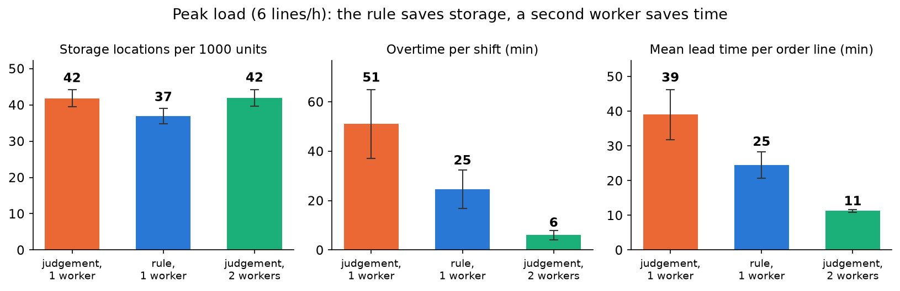
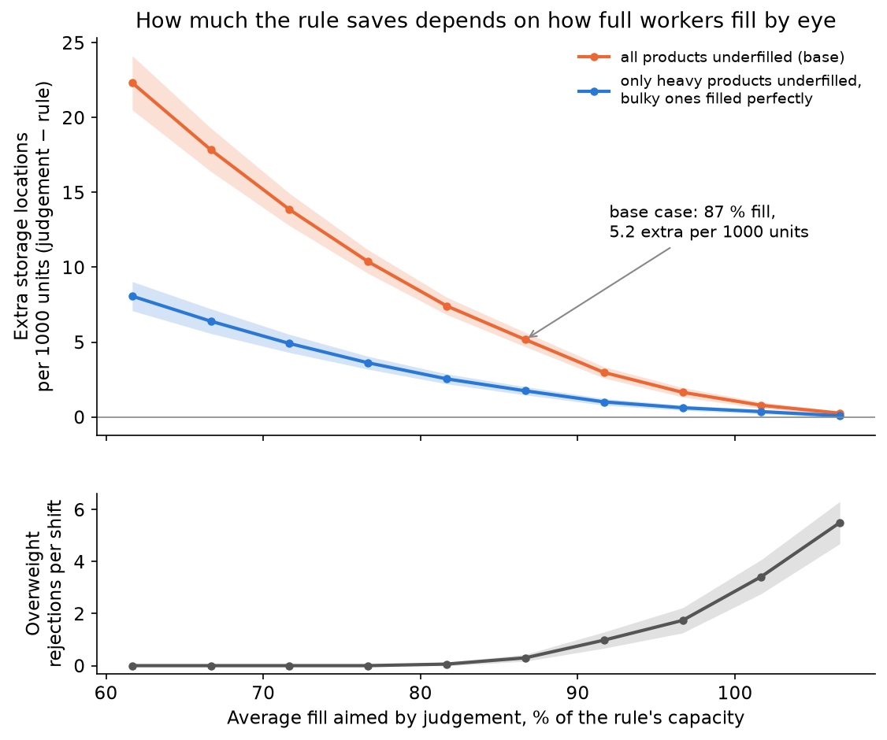

# Tote filling for automated small-parts storage

A packing rule and a discrete-event simulation (Python, SimPy) of a decanting station. At this station a worker puts incoming goods into totes for an automated shuttle storage system.

**All data is synthetic.** The product catalogue, handling times and arrival rates are assumptions. Where possible they rest on public figures or on what I saw working in goods reception. No company data is used, and the results do not describe any real warehouse.

## The question

I worked occasionally in goods reception at a warehouse with an automated shuttle system for small parts. Incoming goods were sorted into totes, and each tote had a weight limit. The system knew every product's weight and package size, yet the worker decided by eye how many units went into a tote.

The project asks two things:

1. **Packing rule:** how many units of a product fit in one tote, limited by weight and by geometry?
2. **Simulation:** if a screen showed that number, how would the station change? How full must workers fill by eye before the rule stops paying off?

## Method

**Packing rule** (`src/packing.py`). The weight bound is `floor(max_load / unit_weight)`. The geometric bound tries all 6 orientations of the package and fills the tote with a regular grid in one orientation. The result is the smaller of the two, and the rule reports which one binds. This is a simple heuristic, not full 3D bin packing. Packages are treated as boxes.

**Catalogue** (`data/sku_catalogue.csv`). 35 synthetic electrical small parts in 10 categories (lamps, sockets, fuses, cable ties and so on). With the base tote (560 × 360 × 200 mm inner, 15 kg limit), 17 products are weight-bound and 18 volume-bound.

**Simulation** (`src/simulation.py`). Order lines arrive at random (Poisson, 4 lines per hour, 6 at peak). A worker takes a tote, decides how many units go in, places them and sends the tote to the lifter.

- *Rule:* the worker reads the number from a screen (0.1 min).
- *Judgement:* the worker fills a random share F of the true capacity, with F ~ triangular(0.65, 0.85, 1.10) per tote, and takes 0.5 min to decide. Mean fill is 87 %. An overweight tote is rejected by the conveyor and the worker removes units.
- Totes hold one product. A small leftover can go into a half or a quarter of a divided tote, and one partly filled divided tote may wait at the desk for the next leftover.
- Each replication is one 8-hour shift that starts empty, so there is no warm-up. Lines that arrive before the end are finished in overtime.

**Statistics** (`src/scenarios.py`, `src/sensitivity.py`). 50 replications per scenario with the same seeds. Common random numbers give each order line the same quantity, fill factors and handling times in every scenario. Differences are paired over seeds and reported with 95 % confidence intervals.

Every number and its source is listed in [`notes/assumptions_and_sources.md`](notes/assumptions_and_sources.md).

## Results

**Scenarios** (means over 50 shifts, one station):

| Scenario | Totes per 1000 units | Overweight rejections per shift | Worker utilisation | Overtime (min) | Mean lead time (min) |
|---|---|---|---|---|---|
| S1 judgement, normal load | 42.7 | 0.3 | 61 % | 11 | 17.8 |
| S2 rule, normal load | 37.6 | 0 | 53 % | 7 | 13.3 |
| S3 judgement, peak | 41.8 | 0.4 | 86 % | 51 | 39.0 |
| S4 rule, peak | 36.9 | 0 | 78 % | 25 | 24.5 |
| S5 judgement, peak, 2 workers | 41.9 | 0.4 | 47 % | 6 | 11.3 |

- **The rule uses 12 % fewer totes,** that is 5.2 fewer storage locations per 1000 units (paired 95 % CI 4.7 to 5.6).
- **At peak, the rule and a second worker solve different problems.** The rule halves overtime (51 to 25 min) and saves totes. A second worker cuts overtime by 88 % (to 6 min) but saves no totes.
- **The lifter is never the bottleneck.** It is busy about 2-3 % of the time.



**Headline: the saving depends on how full workers fill by eye.**



| Mean fill by judgement | 77 % | 82 % | 87 % (base) | 92 % | 97 % | 102 % |
|---|---|---|---|---|---|---|
| Extra totes per 1000 units | 10.4 | 7.4 | 5.2 | 3.0 | 1.6 | 0.8 |
| Overweight rejections per shift | 0 | 0.1 | 0.3 | 1.0 | 1.7 | 3.4 |

In plain words: **if workers fill on average below about 92 % of a tote's capacity, the rule saves more than 3 storage locations per 1000 units.** Below 77 % it saves more than 10. Judgement cannot win both ways. Careful filling wastes space, and bold filling causes rejections.

- About **two thirds of the saving comes from bulky, volume-bound goods.** If workers filled those perfectly and only misjudged weight, the saving at 87 % fill would be 1.8 per 1000 units instead of 5.2.
- The storage saving stays at 4-6 totes per 1000 units when max load (15 / 25 / 35 kg), tote height (150 / 200 / 300 mm), arrival rate (3-7 lines/h) or divider use change.
- **The time saving rests on the assumed decision time.** At 0.5 min per tote, judgement adds 42 min of work per shift. If judging were as fast as reading a screen, it would still add 10 min, from the extra totes.

Other figures in `results/`: units per tote by product (fig. 1), queue length over a peak shift (fig. 2), worker time breakdown (fig. 3), totes per scenario (fig. 4).

## Validation

61 tests pass (`pytest`):

- **Packing** (13 tests): hand-calculated cases, weight-bound and volume-bound, an item that fits in no orientation, a case where the best orientation is not the default, and edge cases for the number of totes.
- **Simulation** (43 tests): with fixed times and F = 1 the model reproduces a hand calculation of totes and busy time. Units in equal units stored in every configuration. No overweight tote reaches storage. Utilisation matches the offered load at low load. Little's law holds for the queue. Common random numbers give identical order lines across scenarios.
- **Scenarios** (5 tests): confidence intervals by hand, paired differences, and that common random numbers narrow the interval.

## Limits

- **All inputs are assumptions.** The catalogue is synthetic, and handling times are calibrated to a remembered 3-5 minutes per tote. The fill factor F is the most important unknown, and it should be measured before quoting a number.
- **The packing rule is a heuristic.** One orientation per tote and a regular grid. Real workers can mix orientations, so the true capacity may be higher. Bags and coils are treated as boxes.
- **One station is modelled.** Stations do not share anything except the lifter, which was never a bottleneck. Lifter faults are not modelled.
- **The result is in totes, not money.** Whether 5 storage locations per 1000 units pay for a screen at the station depends on site costs.

## How to run

Python 3.11 or newer.

```
python -m venv .venv
.venv\Scripts\activate          (Windows. On Linux/macOS: source .venv/bin/activate)
pip install -r requirements.txt
pytest
python -m src.scenarios          # S1-S5, about 5 s
python -m src.sensitivity        # sensitivity sweeps, under a minute
python -m src.plots              # figures into results/
```

The seeds are fixed, so a rerun reproduces the files in `results/` exactly.

## Files

```
data/sku_catalogue.csv            synthetic product catalogue
src/packing.py                    packing rule
src/simulation.py                 SimPy model of the station
src/scenarios.py                  scenarios S1-S5, confidence intervals
src/sensitivity.py                sensitivity analysis
src/plots.py                      figures
tests/                            unit tests and simulation checks
results/                          CSV results and figures
report/raportti.md                short report in Finnish
notes/assumptions_and_sources.md  every number with its source
```
