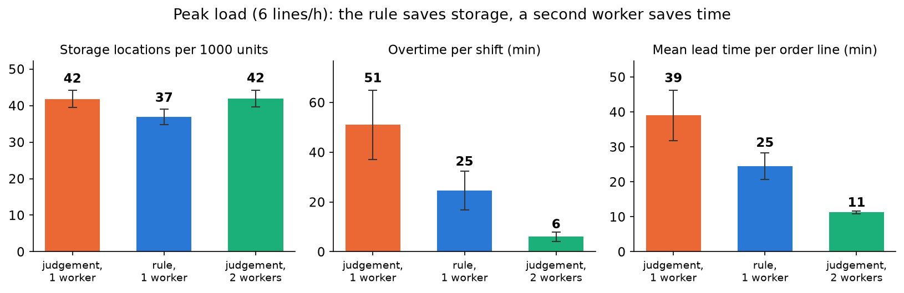
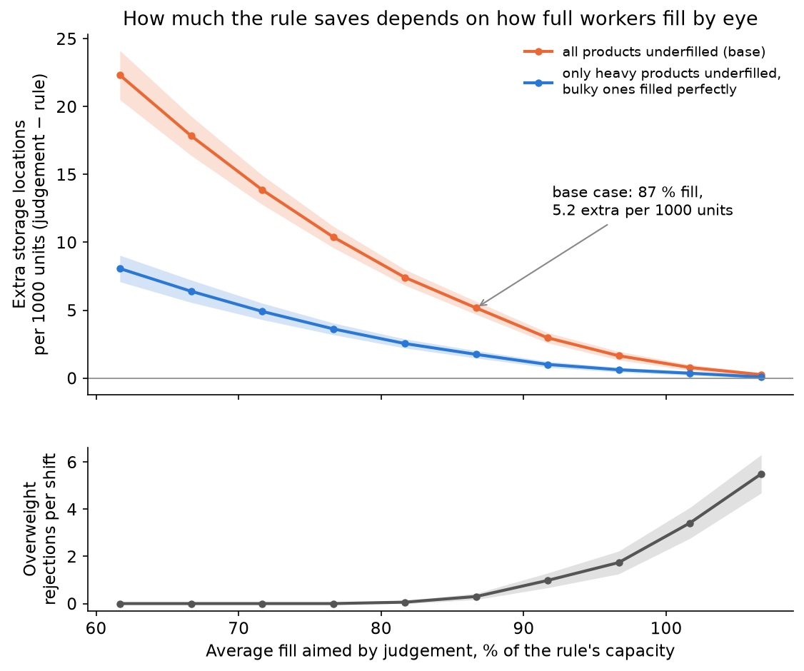

# Laatikoiden täyttö automaattivarastoon: laskusääntö ja simulointi

Albin Oruglica, marraskuu 2026

## 1. Kysymys

Automaattisessa pientavaravarastossa saapuvat tuotteet puretaan laatikoihin, jotka shuttle-järjestelmä vie hyllyyn. Jokaisella laatikolla on painoraja. Järjestelmä tietää jokaisen tuotteen painon ja pakkauksen mitat. Silti työntekijä päättää silmämääräisesti, montako kappaletta laatikkoon menee.

Tein työtä satunnaisesti tällaisen varaston tavaranvastaanotossa. Silloin mietin, että kone voisi laskea kappalemäärän valmiiksi. Tässä työssä rakensin sen laskusäännön ja simuloin, mitä se muuttaisi täyttöasemalla.

Kysymyksiä oli kaksi:

1. Montako kappaletta tuotetta mahtuu yhteen laatikkoon, kun rajana on paino ja tila?
2. Paljonko laskusääntö säästää laatikoita ja työaikaa verrattuna silmämääräiseen täyttöön? Kuinka huonosti silmämääräisen täytön pitää osua, jotta sääntö kannattaa selvästi?

## 2. Lähtötiedot

Kaikki aineisto on keksittyä mutta uskottavaa. Mitään yrityksen todellista dataa ei ole käytetty, eivätkä tulokset kuvaa mitään todellista varastoa. Jokainen luku ja sen lähde on listattu tiedostossa `notes/assumptions_and_sources.md`.

- **Tuotteet:** 35 sähkötarviketta kymmenestä ryhmästä, esimerkiksi lamput, pistorasiat, sulakkeet ja nippusiteet. Mitat ja painot valitsin käsin uskottaviksi.
- **Laatikko:** sisämitat 560 × 360 × 200 mm (oletus, yleinen 600 × 400 mm:n pohja). Painoraja 15 kg on oma oletukseni. Valmistajan julkinen yläraja Cuby-järjestelmälle on 35 kg, ja käytin sitä herkkyysanalyysin ylärajana.
- **Saapuvat rivit:** keskimäärin 4 tilausriviä tunnissa yhdelle asemalle, ruuhkassa 6. Rivin kappalemäärä arvotaan tuotekohtaiselta väliltä.
- **Käsittelyajat:** rivin aloitus 1,5 min, laatikon nouto ja lähetys 1,0 min, yhden kappaleen asettelu 5 s. Arvoilla yksi laatikko vie keskimäärin noin 4 minuuttia, mikä vastaa omaa muistikuvaani 3-5 minuutista.
- **Päätösaika:** näytöltä luettuna 0,1 min, silmämääräisesti 0,5 min. Molemmat ovat oletuksia.
- **Hissi:** 400 työkiertoa tunnissa (julkinen lehtitieto vuodelta 2016, vain suuntaa antava).

## 3. Malli

**Laskusääntö.** Painoraja antaa ylärajan `floor(painoraja / kappaleen paino)`. Tilaraja kokeilee pakkauksen kaikkia kuutta asentoa ja täyttää laatikon säännöllisellä ruudukolla yhdessä asennossa. Tulos on näistä pienempi, ja sääntö kertoo, kumpi raja sitoo. Sääntö on yksinkertainen heuristiikka eikä täysi 3D-pakkausongelman ratkaisu. 15 kg:n rajalla 17 tuotetta on painon rajoittamia ja 18 tilan rajoittamia.

**Simulointi.** Rakensin diskreettitapahtumasimulaation Pythonilla ja SimPy-kirjastolla. Mallissa tapahtuu näin:

1. Tilausrivit saapuvat satunnaisesti (Poisson-prosessi).
2. Työntekijä ottaa rivin, hakee laatikon ja päättää kappalemäärän.
   - **Säännöllä** hän lukee luvun näytöltä.
   - **Silmämääräisesti** hän täyttää laatikosta satunnaisen osuuden F todellisesta kapasiteetista. F arvotaan jokaiselle laatikolle kolmiojakaumasta (0,65, 0,85, 1,10), joten laatikko täyttyy keskimäärin 87-prosenttisesti. Työntekijä näkee tilan mutta ei painoa. Siksi vain painavat tuotteet voivat ylittää painorajan.
3. Liian painavan laatikon kuljetin hylkää. Työntekijä poistaa kappaleita ja lähettää laatikon uudestaan. Poistetut kappaleet menevät seuraavaan laatikkoon.
4. Laatikko menee hissin kautta hyllyyn ja vie yhden varastopaikan.

Laatikossa on aina vain yhtä tuotetta. Pieni loppuerä voi mennä jaetun laatikon puolikkaaseen tai neljännekseen, ja yksi puolitäysi jaettu laatikko voi odottaa pöydällä seuraavaa loppuerää.

Yksi toisto on yksi 8 tunnin vuoro, joka alkaa tyhjästä. Siksi lämmittelyjaksoa ei tarvita. Vuoron lopussa jonossa olevat rivit tehdään ylitöinä. Ajoin jokaisesta skenaariosta 50 toistoa samoilla siemenluvuilla. Käytin yhteisiä satunnaislukuja, eli sama tilausrivi saa samat määrät ja ajat joka skenaariossa. Silloin skenaarioiden ero voidaan laskea pareittain, ja luottamusvälit kapenevat.

**Mallin tarkistus.** 61 testiä menee läpi. Kiinteillä ajoilla ja F = 1 malli toistaa käsin lasketut laatikkomäärät ja työajat. Kappaleita ei katoa eikä synny. Kevyellä kuormalla käyttöaste vastaa tarjottua työmäärää, ja jono noudattaa Littlen lakia.

## 4. Tulokset

**Skenaariot** (keskiarvot 50 vuorosta, yksi asema):

| Skenaario | Laatikoita / 1000 kpl | Hylkäyksiä / vuoro | Käyttöaste | Ylityö (min) | Läpimenoaika (min) |
|---|---|---|---|---|---|
| S1 silmämääräinen, normaali | 42,7 | 0,3 | 61 % | 11 | 17,8 |
| S2 sääntö, normaali | 37,6 | 0 | 53 % | 7 | 13,3 |
| S3 silmämääräinen, ruuhka | 41,8 | 0,4 | 86 % | 51 | 39,0 |
| S4 sääntö, ruuhka | 36,9 | 0 | 78 % | 25 | 24,5 |
| S5 silmämääräinen, ruuhka, 2 työntekijää | 41,9 | 0,4 | 47 % | 6 | 11,3 |

Sääntö käyttää 12 % vähemmän laatikoita. Se on 5,2 varastopaikkaa vähemmän tuhatta kappaletta kohti (parittainen 95 %:n luottamusväli 4,7-5,6). Ruuhkassa sääntö puolittaa ylityön. Toinen työntekijä vähentää ylityötä 88 %, mutta ei säästä yhtään laatikkoa. Ne ratkaisevat siis eri ongelmia. Hissi on käytössä vain 2-3 % ajasta, joten se ei ole pullonkaula.

**Herkkyysanalyysi.** Tärkein epävarma luku on se, kuinka täyteen työntekijät täyttävät silmämääräisesti. Vaihtelin jakauman huippua välillä 0,60-1,05.

| Keskimääräinen täyttö | 77 % | 82 % | 87 % (perus) | 92 % | 97 % | 102 % |
|---|---|---|---|---|---|---|
| Ylimääräiset laatikot / 1000 kpl | 10,4 | 7,4 | 5,2 | 3,0 | 1,6 | 0,8 |
| Hylkäyksiä / vuoro | 0 | 0,1 | 0,3 | 1,0 | 1,7 | 3,4 |

- Jos työntekijät täyttävät keskimäärin alle 92 % laatikon kapasiteetista, sääntö säästää yli 3 varastopaikkaa tuhatta kappaletta kohti. Alle 77 %:n täytöllä säästö on yli 10.
- Silmämääräinen täyttö häviää kummassakin suunnassa. Varovainen täyttö tuhlaa tilaa, ja rohkea täyttö tuottaa hylkäyksiä.
- Noin kaksi kolmasosaa säästöstä tulee kookkaista, tilan rajoittamista tuotteista. Jos työntekijät täyttäisivät ne täydellisesti, säästö perustapauksessa olisi 1,8 eikä 5,2.
- Säästö pysyy välillä 4-6 laatikkoa tuhatta kappaletta kohti, kun painoraja (15, 25, 35 kg), laatikon korkeus (150, 200, 300 mm), saapumistahti (3-7 riviä tunnissa) tai jakajien käyttö muuttuu.
- Ajansäästö riippuu oletetusta päätösajasta. Puolen minuutin päätösajalla silmämääräinen täyttö lisää työtä 42 minuuttia vuorossa. Jos arviointi olisi yhtä nopeaa kuin näytön lukeminen, lisätyötä jäisi silti 10 minuuttia, koska laatikoita on enemmän.

## 5. Johtopäätökset

1. **Sääntö säästää varastotilaa lähes kaikilla oletuksilla.** Säästön koko riippuu ennen kaikkea siitä, kuinka täyteen työntekijät nyt täyttävät. Perustapauksessa säästö on 12 % laatikoista.
2. **Ruuhkaan sääntö ja lisätyöntekijä ovat eri työkaluja.** Lisätyöntekijä lyhentää jonoja ja ylityötä tehokkaammin. Sääntö säästää lisäksi varastopaikkoja. Ne eivät sulje toisiaan pois.
3. **Ennen päätöstä kannattaa mitata kaksi asiaa:** kuinka täysiä laatikot todellisuudessa ovat ja kauanko kappalemäärän arviointi kestää. Molemmat voi mitata muutaman päivän otannalla.

**Rajoitukset.** Kaikki syötteet ovat oletuksia. Pakkaussääntö käyttää yhtä asentoa koko laatikolle, joten todellinen kapasiteetti voi olla suurempi. Pussit ja kelat käsitellään laatikon muotoisina. Malli kuvaa yhtä asemaa, eikä se sisällä hissin vikoja. Tulos on laatikoina eikä euroina. Se, kannattaako näyttö asemalle, riippuu varastopaikan hinnasta.

**Jatkokehitys.** Seuraavaksi rakentaisin sekalaatikot (useampi tuote samassa laatikossa), oikean 3D-pakkauksen ja tuotteiden sijoittelun hyllyyn (slotting). Oikealta asiakkaalta pyytäisin tuotteiden master-datan, mitatut käsittelyajat ja varaston todellisen painorajan.
